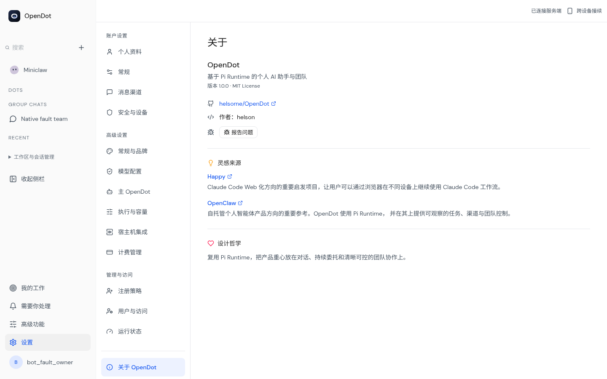
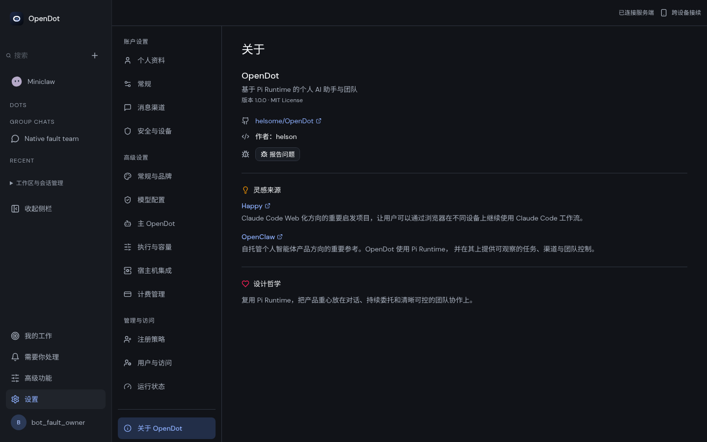
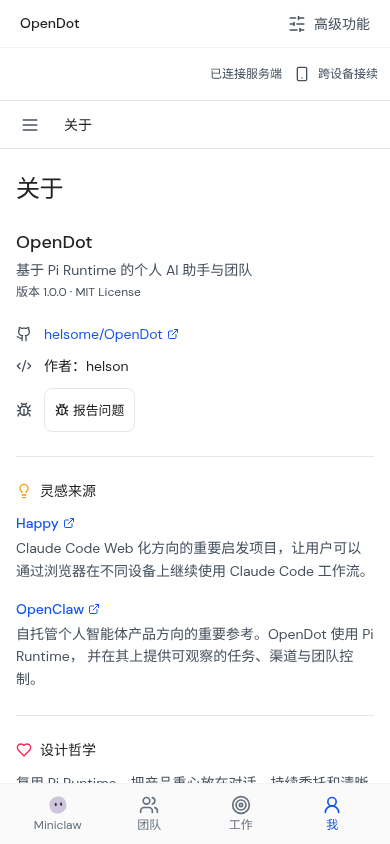
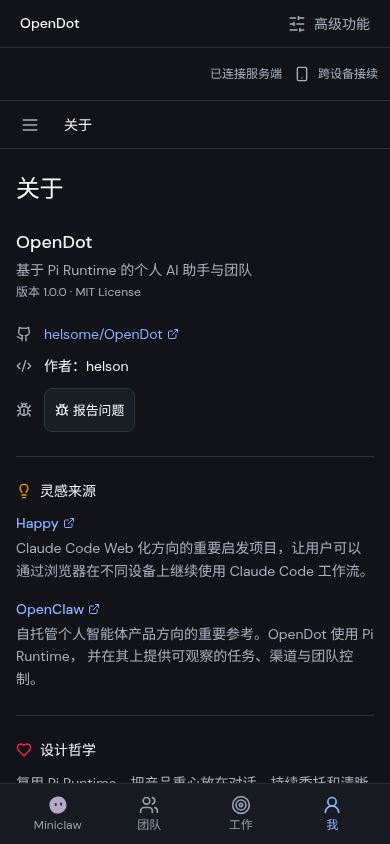

# OpenDot brand and repository compatibility

The canonical repository is `yftx293/OpenDot`. Package metadata, repository
links and the user-confirmed bug report destination use this path.
Historical stored Goal/webhook repository references are not rewritten.

The UI/design work is #66; this follow-up completes current repository metadata
and About/report labels for #64 without renaming execution/persistence identities.

| Surface                        | Current behavior                                                                                                       |
| ------------------------------ | ---------------------------------------------------------------------------------------------------------------------- |
| Project/app                    | OpenDot; user-customized site names remain supported                                                                   |
| Dot names                      | Actual stored Profile name; personal/legacy names are preserved                                                        |
| Package metadata               | OpenDot descriptions and canonical repository/homepage/bugs URLs                                                       |
| npm package names/versions     | Unchanged, including `miniclaw`, `miniclaw-web`, `miniclaw-desktop`, runner and `@miniclaw/cloud-agent`                |
| Dependencies/scripts/lockfiles | Unchanged; metadata changes do not upgrade the SDK or require a new lock resolution                                    |
| Desktop                        | `cc.miniclaw.desktop`, narrow IPC bridge and existing `Miniclaw` user-data directory retained                          |
| Runtime/data                   | SQLite tables, migrations, cookies, storage keys, `MINICLAW_*`, API/tool identifiers and memory reserved keys retained |
| Cloudflare                     | Existing worker/binding/class/namespace/DO identities retained; no deployment or resource rename                       |
| Docker                         | Existing `helsome/miniclaw-agent` image/tag references retained; no registry move or publication                       |
| Diagnostic API                 | Legacy `Miniclaw版本` JSON key retained; UI presents it as `OpenDot版本`                                               |

The About page no longer attributes the current execution engine to Claude Agent
SDK: it describes the actual Pi Runtime integration. Bug-report confirmation,
fixed CLI repository argument, issue URL fallback and attribution agree on
OpenDot. Authentication, confirmation, rate limits and report contents otherwise
retain their existing behavior.

Validation: all non-metadata package configuration was compared against the
previous tree for all five packages; names, versions, repository subdirectories,
dependencies, scripts and lockfiles are unchanged. Generated/full typecheck,
browser types and backend/Web/Runner builds passed. The existing advanced-page
browser acceptance passed (49.3s), including real authenticated HTTP/SQLite,
light/dark geometry, mobile/tablet focus handling and the canonical About link;
model calls remained zero. Exact-head CI is recorded in the PR.

Desktop 1440×900 and mobile 390×844 About views (Chromium emulation):

 

External review remains Pending: existing GitHub Goal/webhook references,
external service integrations, signed/native distribution, Cloudflare staging
and registry credentials. Main's previously observed Docker publication failure
(`Username and password required`) is a publication blocker, distinct from
product CI. This metadata change does not repair credentials, edit stored Goals,
move namespaces, alter production resources or claim real-device acceptance.

Rollback reverts metadata/copy/links without a data migration. Prefer keeping the
canonical repository URLs, since long-term availability of old redirects is not
a compatibility guarantee. Keep the preserved internal identifiers stable until
a separately reviewed migration exists.
