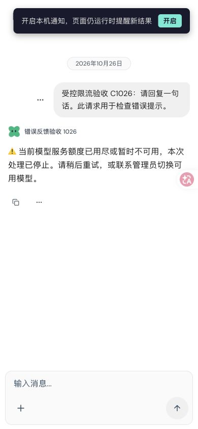
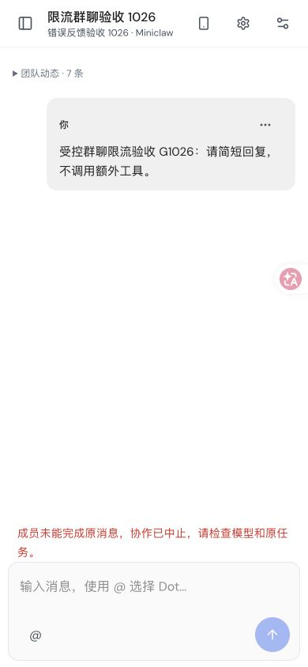

# 聊天错误反馈 · #75 · 2026-10-26

实际 Chrome 通过可见入口新建 Dot、一次选择两位 Dot 建群、显式启用成员协作，
检查 HTTP 429 时的单聊与群聊错误反馈。模型接口是隔离的受控 HTTP 429 服务，
本次真实供应商请求为 **0**；不是 WorkBuddy 三轮实聊通过。原始真实 WorkBuddy
四次 429 的失败截图仍在 [原验收目录](../workbuddy-current-2026-10-26/README.md)。

后台源版本为 `6f508c8b05744e22a6b4980023ee932b5d57057f`：整合 #99、#100 的
图标与 #102 的错误识别修复。实际文件字节核对 1965 个跟踪文件；Web/runner 的
374 个构建输入与此前 d44 版本相同，后台重新编译。随后只修改 Web 的终止失败
呈现并构建 `8c389742e556003e59c55304b2a92bb70a01db30`，后台产物保持原 hash。
[版本与产物记录](ui-epoch.json)、[字节核对](source-audit.json)保留这一边界。

## 单聊不再空闲后无提示

一次受控模型请求后，界面显示中文终止提示。数据库恰好保留一条用户输入和
一条错误提示；刷新、在群聊与单聊之间切换并搜索找回后，消息和调用数不增加。
[规范消息记录](canonical-message-check.json)里的 sender_name 是系统存储值，
页面仍显示用户所命名的当前 Dot，不把该提示作为供应商生成的答案。

[桌面浅色](single-desktop-error-light.png)、[手机深色](single-mobile-error-dark.png)、
[390×480 输入框获得焦点](single-keyboard-error.png)均保留原始像素。

## 群聊失败提示更易发现

原来的失败原因是 12px 灰色状态文字。现在沿用既有错误色，使用 14px 字号、
24px 行高与 `role=alert`。正常进度、停止和完成时的既有逻辑保持原样。

| 同一失败群聊 | 手机深色原图 |
| --- | --- |
| 修改前 | [12px 灰色状态文字](before-group-mobile-dark.png) |
| 修改后 | [14px 错误色提示](after-group-mobile-dark.png) |

两位 Dot 的基础文字权限来自正常建群流程，没有预写额外工具 grant。讨论中
第一位 Dot 的实际原生 Task 10 尝试 1–4 都遇到受控错误；Run 明确失败，
两名成员租约都是 done，没有 Bot 公共答案，保留一条用户消息与七条系统事件。
这是终止错误，不能把租约结束说成模型成功。群聊提示仍为通用的原消息失败，
尚不是专门的额度诊断。关联见 [原生记录](group-native-check.json)。

**更改 Web 样式后继续使用原 Group、原 Run 和原 Session。** 刷新后的 Run、
调用上限、已用次数与消息均不变，总受控请求仍是单聊 1 次加群聊 4 次。
[更新后对账](after-ui-reload-native-check.json)没有借重建群聊或重发消息通过。

## 布局、动画与门禁

- [桌面浅色](after-group-desktop-light.png)、[桌面深色](after-group-desktop-dark.png)、
  [手机深色](after-group-mobile-dark.png)均可读。
- [键盘高度](after-group-keyboard-light.png)时，警告底部 347，输入框顶部 358、
  底部 417，视口 390×480，文档宽 390。群聊设置关闭按钮为 44×44，可见可达。
- 实际观察两个可见 Dot 列表头像的 `bot-breathe` 动画运行，周期 6.4 秒；
  当前对话的前后 transform 实际改变，离屏头像按既有设计暂停。
  [动画观测](avatar-animation.json)不是物理手机或所有偏好模式的证明。
- 标准仓库配置的两个既有消息/停止控件测试文件共 5 项通过；Web 类型检查和
  Vite production 构建通过。日志均通过异常输出检查，见 [门禁记录](gate-results.json)。

最初为避免覆写运行中的后台产物，两个纯 UI 套件先使用相同 alias、无后台全局
编译的临时配置通过；测试实例停止后，再用标准仓库配置完整重跑这两个文件通过。
控制脚本和只读观测器的准备错误保留在 [harness 记录](harness-observations.json)，
没有调整产品期限、模型重试或生产断言。

首次发送窗口 38 条事件、最终刷新窗口 62 条事件均未截断，未见观察到的 HTTP
失败或控制台 warning/error；中间三次事件窗口发生过截断，因此不声明完整 HTTP
覆盖。窗口文件只保存方法、路径和状态，没有鉴权头。

测试后恢复浅色与浏览器尺寸、退出生成的 localhost 账户、关闭测试页和临时实例，
私有 SQLite 快照 quick_check 通过。用户原有 127.0.0.1:3000 服务与配置没有修改。

当前 WorkBuddy 自然三轮对话仍未复测通过；Cloudflare staging、物理手机、真实
输入法和 warm IPC 连续复用均不由这些受控截图证明。Grok Bot 原生应用本轮因
Mac 锁屏无法读取，没有新增其实际交互对照结论。
