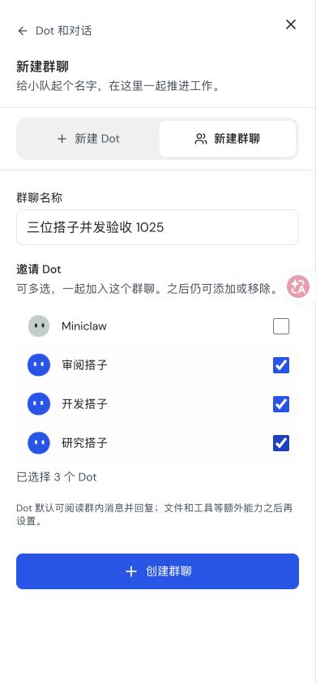
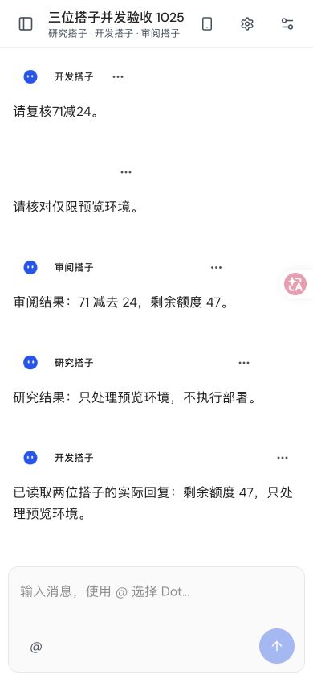
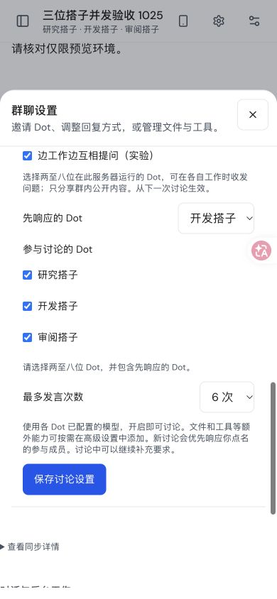
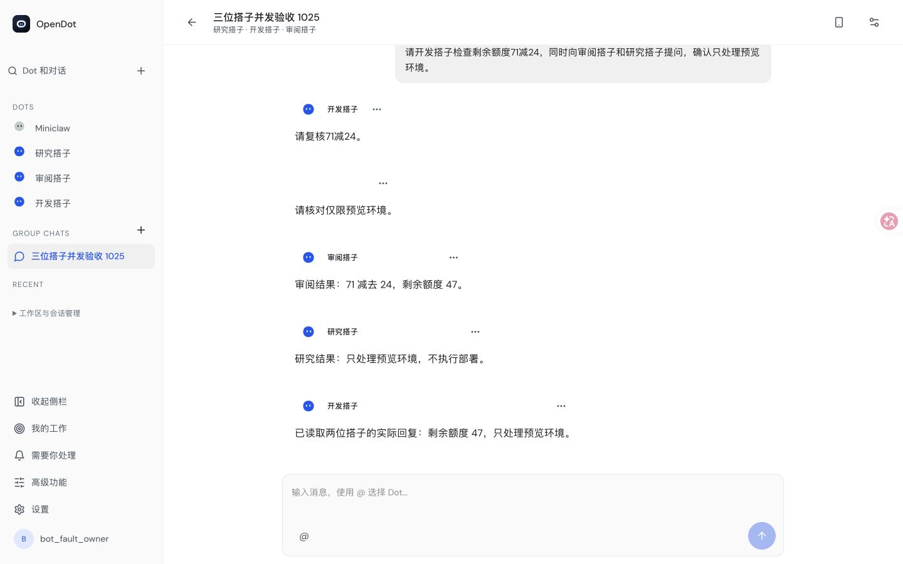
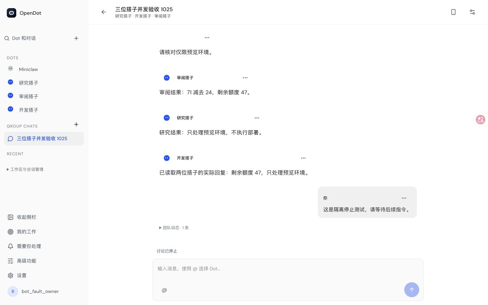
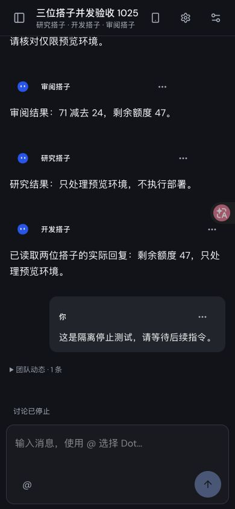
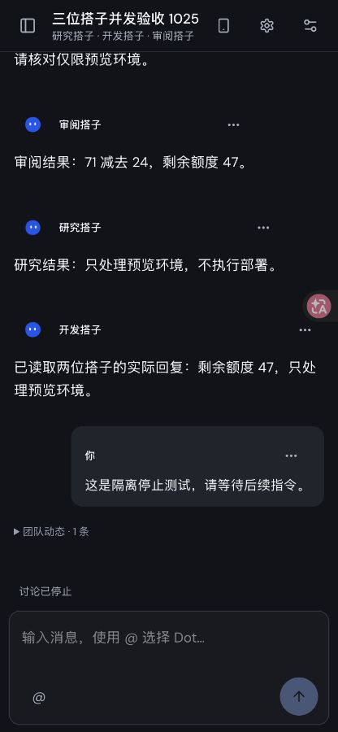

# 三成员协作的 Chrome 验证（2026-10-25）

本组截图使用真实 Chrome、Node Pi Durable 与隔离数据库，**模型推理为受控本机 fixture**。
不是 WorkBuddy、Cloudflare 或物理手机验收。实际产品路径从加号、多选三位 Dot、
建群和显式开启实验协作开始；没有预写群聊消息或 fixture grant。

开发搭子在自己的工作尚未结束时询问另外两位：审阅搭子返回余额 47，
研究搭子返回预览范围；开发搭子的后续原生输入真正包含两条回复，再发布唯一最终结果。
该讨论实际调用 6 次、5 个原生输入；刷新后原 message/input IDs 保留，调用数仍为 6。
第二次讨论通过桌面 Enter 发出；界面 Stop 后持久状态 cancelled、成员 lease done，
挂起模型连接关闭，没有多余最终回复，累计调用 7 次。关联见 [原生证据](native-proof.json)。

自动浏览器用例通过，包括手机 390×844、键盘高度 390×480、桌面 1440×900，
多选建群、默认关闭、开启新模式、实际回复及刷新不重复；新增选择提示断言后再次通过。
Chrome 手动检查还覆盖了浅/深色与 Stop。键盘尺寸输入框 top=351、bottom=417，
在 480px 视口内；设置关闭按钮始终 44×44px，滚动后仍可见。

观测限制：首个登录后网络窗口 62 条且未截断，API 错误 0，另有 `/favicon.ico` 404。
后续刷新/Stop 窗口发生截断，不声明整段 HTTP 全覆盖通过；另一个短窗口 10 条未截断。
可见 console error 为 0。原生终止与消息结果通过持久记录另行核对。

## 一次邀请三位 Dot

## 手机最终回复

## 已修正三成员设置提示

## 桌面刷新与停止

## 深色

