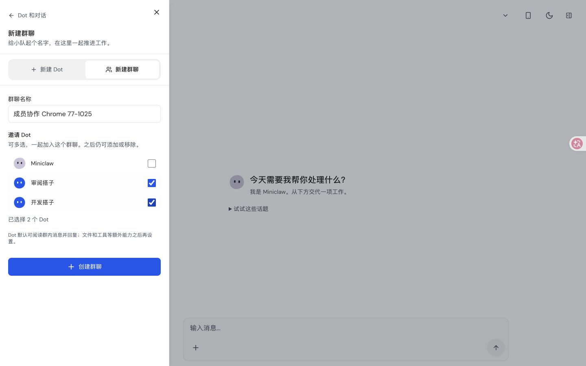
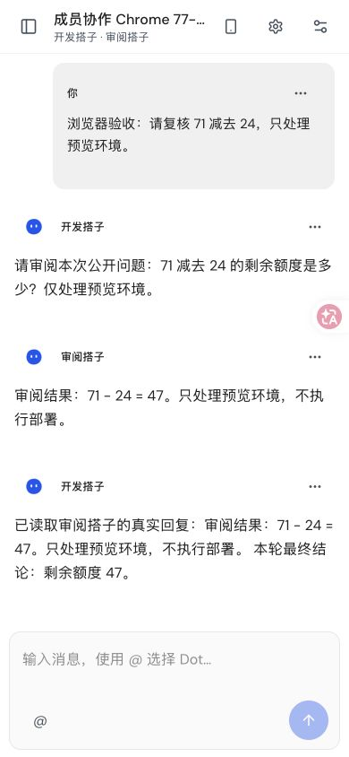
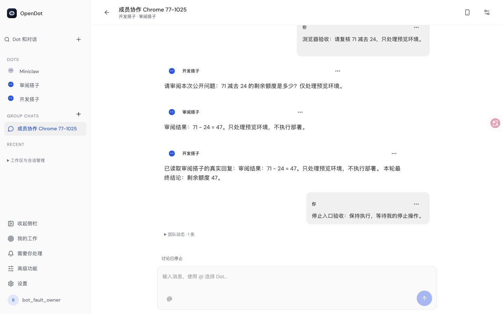
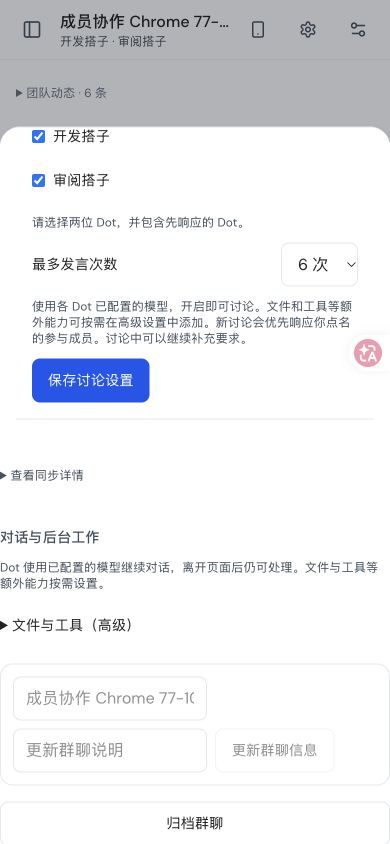
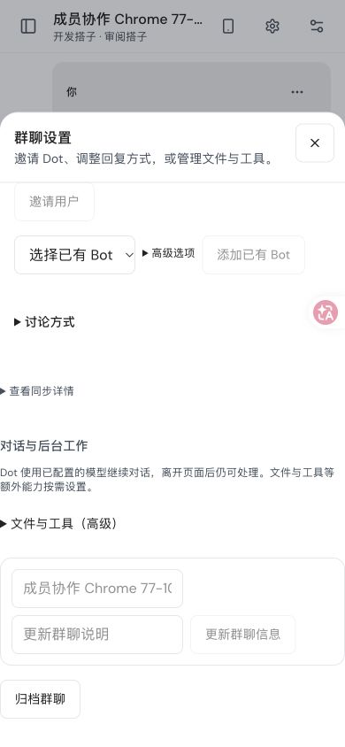
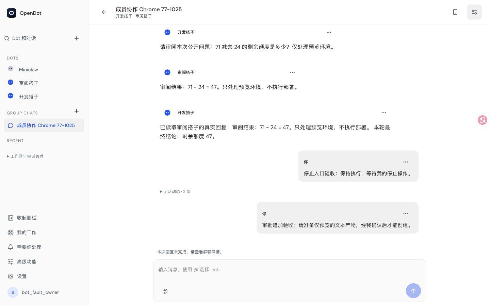
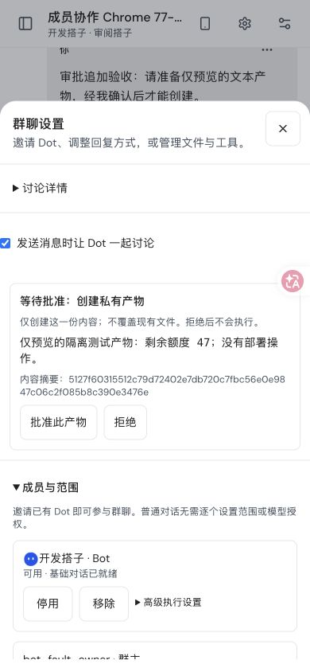
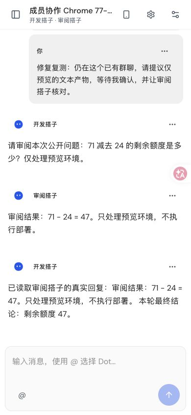
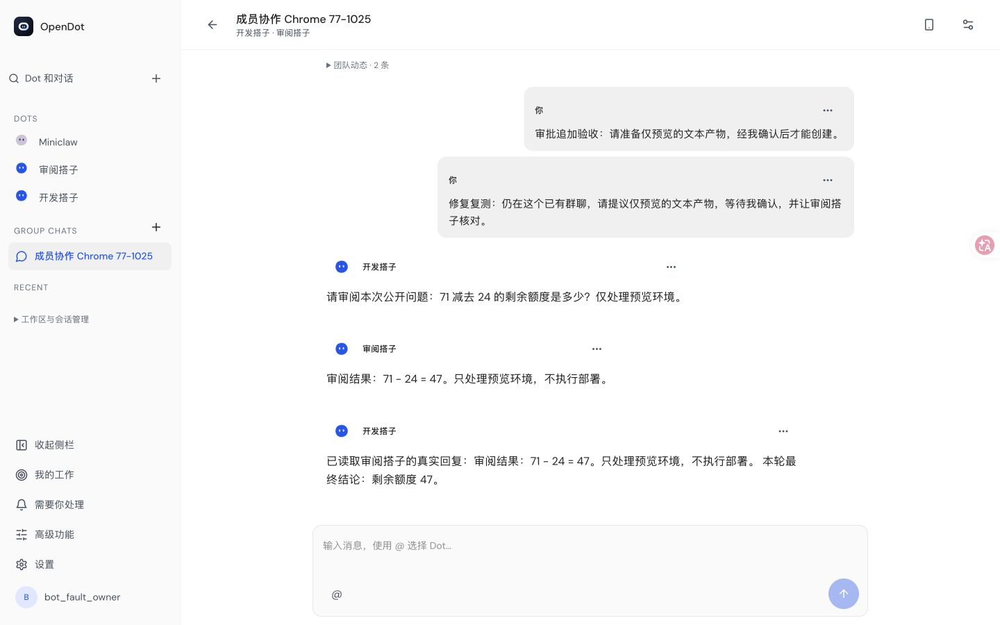

# Chrome 成员互聊与设置回归（2026-10-25）

这是独立临时数据目录中、实际 Node / Product / Pi Durable 的浏览器验收；模型为可控 loopback 响应，**不是 WorkBuddy 实聊**。用户现有的 3000 服务和真实群聊数据未修改。

WorkBuddy 三轮单聊、群聊的真实验收仍见[原始截图及记录](../workbuddy-acceptance-2026-10-24/README.md)。不要把两组结果合并为新的真实模型通过结论。

## 创建与互聊

通过可见的 ➕ → 新建群聊，一次选择两个 Dot；不要求选择 Workspace。讨论实验开关默认关闭，明确启用并保存后仍未调用模型。

390 × 844 Chrome 视口中，开发搭子向审阅搭子提问，真实消费对端原生回复后发布 47 的最终结论。4 次模型请求；刷新前后消息 ID 和请求数保持不变。此处“真实消费”指原生运行时消费，不表示模型供应商为真实 WorkBuddy。

随后在桌面发起新轮，点击停止；Run 为 `cancelled`（界面显示已停止），等待请求已释放，旧轮结果不再发布。

## 群聊设置滚动出口

原先设置内容向下滚动后，关闭按钮移动到视口上方（top = -1076.4）。新的固定标题栏保留 44 × 44 关闭按钮；深滚动后仍可见并可关闭。自动浏览器用例覆盖桌面、390 × 844、390 × 480 键盘高度。

## 原始失败与后续复测

原始失败：在同一个既有群聊里显式追加产物权限后，新一轮在模型调用前报 `GROUP_DISCUSSION_SESSION_IDENTITY_CHANGED`。下面保留失败截图；修复后的同群复测见后文。

新增成员互聊自动浏览器用例通过；完整创建/导航套件 8 项中 7 项通过，单聊项因测试工作树缺少编译后的 agent-runner 而失败。后续讨论套件未执行。完整回归和 CI 仍有已记录失败，保持 Draft。

正向首轮 Chrome 的网络观察缓冲发生截断；未见的早期请求不能视为通过。后续追加授权失败轮的网络记录完整，HTTP 202/200 并不代表对话成功。控制台观察期间没有错误；主动停止临时后端后的断线不作为推理失败。

## 修复后：原群聊、原 Session 的审批续聊

同一个群聊 `887fb67b-59bb-4552-b6d0-655d97bce88b`，保留两个 Group×Dot Session 和 Conversation；没有重建群聊，也没有在复测前换发授权。默认权限首轮、Stop 和追加授权失败的历史均保留。

修复后手机端发送一次新问题：A 提问，B 回答，A 等待精确产物审批；审批前文件不存在，批准后内容与批准摘要完全一致。A 原生消费 B 的回复并给出最终结论。本 Run 完成，4 次实际模型请求、3 个原生输入。

[脱敏原生关联证据](permission-fixed-native-proof.json)保存原会话身份、旧失败 Run、新 Run、问题/回复因果、实际 Submission/Task 与审批记录。刷新前后 canonical 消息 ID、原生输入、dispatch 和累计 provider 请求数（9）相同，没有新增推理。本次网络窗口均未截断，观察到的 HTTP/加载失败和控制台错误均为 0；刷新后的观察从重新启用 Network 开始，不宣称覆盖初始导航全部请求。

补充回归：15 个文件、72 项通过（495.30 秒）。此前七项建群/导航/单聊通过，新增授权 UI 用例在补齐“查看请求”动作后通过（17.3 秒），六项旧讨论浏览器用例全部通过（1.5 分钟）。原始缺 runner 和测试漏点入口的失败日志均保留；没有增加超时或跳过断言。仍是 synthetic 验证，不代替 WorkBuddy 新模式实聊、Cloud 或完整 CI。
