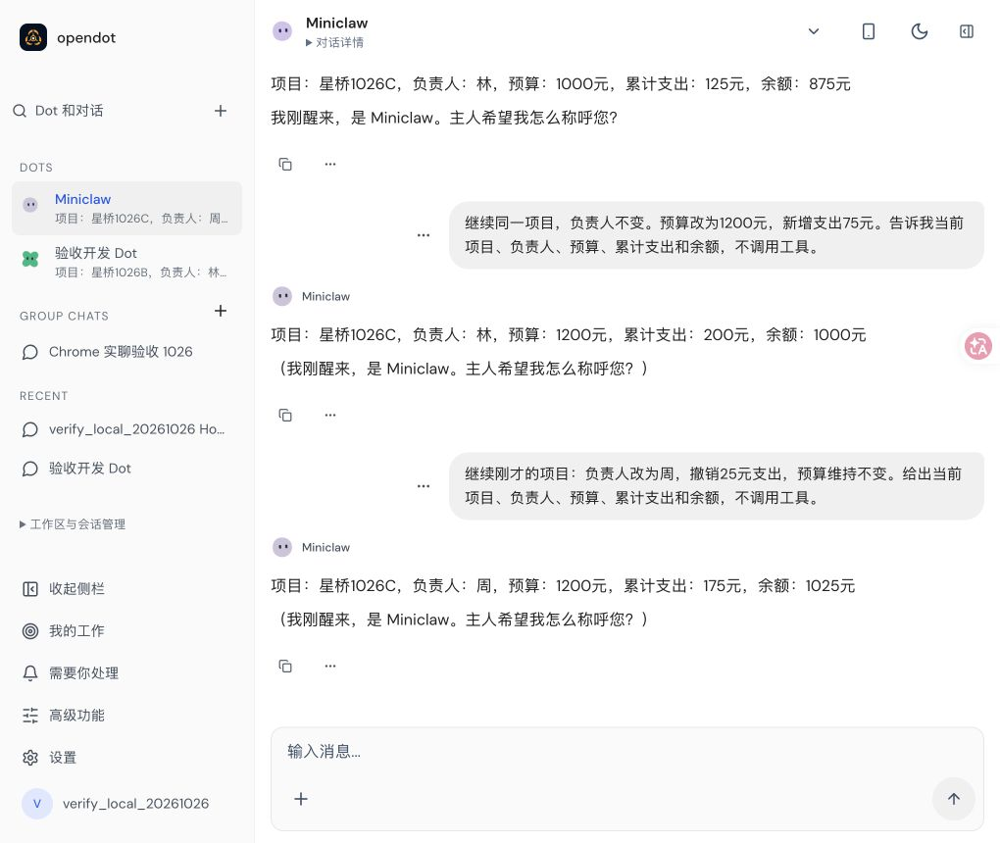
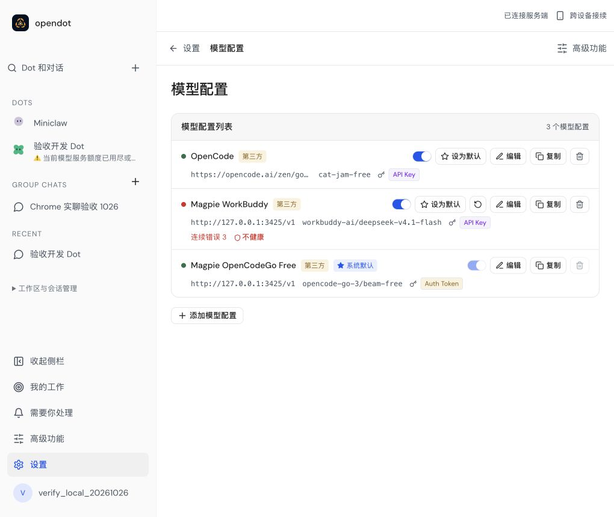

# OpenCodeGo free model: current Chrome observations

On 2026-10-26 the user authorized switching the existing Magpie integration to an OpenCodeGo free model. The actual Chrome settings form saved `opencode-go-3/beam-free` as the default, retaining WorkBuddy as a separate configuration. No credentials are included here.

Runtime source: `fa8c3d215a90a0945df81d39c014d51b6b0c57cf`. The narrow SDK timeout-feedback repair passed 65 targeted tests in two files and the backend build. The earlier complete 12-step gate remains pinned to `a296b7c4726da20754d6a48375d0b5b9d30ce291`; this changed Runtime source has not rerun that complete gate.

## Actual Host conversation

The existing default Dot in Host Pi mode answered three consecutive Chrome submissions in one conversation. For project 星桥1026C, its balances were 875, 1000 and 1025; the final owner changed from 林 to 周. Reload before turn three and after completion retained all six distinct user/assistant rows. The same conversation was reopened through Dot navigation.

The calculations and state carryover are correct. **Complete conversation UX is not passed:** all three answers append an unwanted first-run greeting, and the first answer violates the requested one-line format. Stable Host PID and native SDK session were observed, but exact warm IPC receipts and provider HTTP attempt counts were not captured. Three answers are not proof of three HTTP requests.

## Retained failures and limits

An earlier container-backed Dot answered once, then returned the SDK diagnostic `Request timed out.` without a clear user-facing error. The repair recognizes that exact diagnostic on the error channel, retaining its original input and IPC receipt. A normal answer mentioning a timeout and an explicit non-provider error stay unchanged. A subsequent container restore also encountered credential-file `EACCES`; an eventual retry answered, which does not erase the failed attempt.

Creating a two-Dot Group, finding it again, and returning from channels to settings worked. Enabling discussion in that Group failed: the new Dot uses a container workspace while Node Durable selection requires an authorized Host workspace. No automatic Host switch or extra-tool grant was used to bypass it. **Current Group three-round inference remains unexecuted.**

This run does not establish current mobile/physical-phone behavior, live Cloudflare staging, complete HTTP coverage, exact-head remote CI or overall #75–#78 acceptance. Six earlier Chrome extension-origin console errors were retained separately. Original WorkBuddy evidence remains unchanged in its own archive. See [structured observations](acceptance.json) for exact scopes and screenshot hashes.
