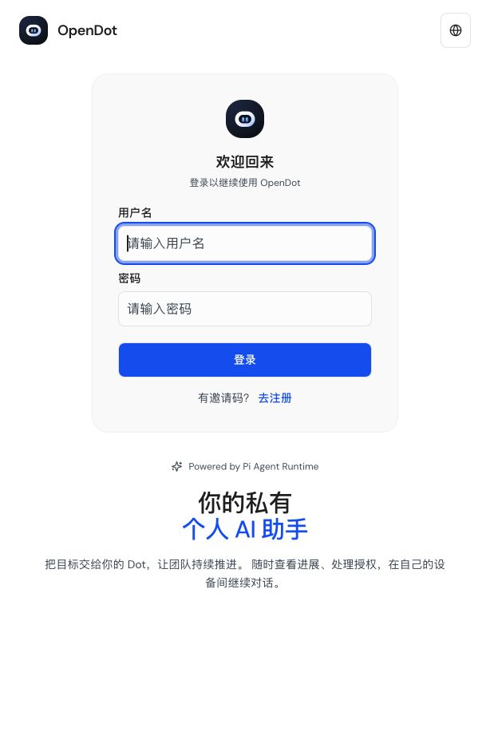

# Robot application identity

The actual local login page was refreshed on 2026-10-26 after the Web build. Both product marks now display the approved white robot with blue eyes. The existing Chrome shell was separately observed loading `/assets/miniclaw-icon-DA0N_xNI.svg`, with natural width 1024; its served bytes match `assets/miniclaw-icon.svg`.

Application marks use the fingerprinted SVG. The wordmark and notification fallback use revisioned URLs; generated favicon, Apple Touch and PWA resources share the approved artwork and content revision. The unused old `loading-logo.svg` was deleted. Custom Dot portraits remain individual identities.

Validation: Web types and production build passed; approved raster/native export checks passed (3 tests); frontend identity checks passed (6 tests); the existing built-product browser test passed its desktop 1440×900 and mobile 390×844 login/shell/resource checks, with zero model requests. This does not establish refresh of previously installed OS launchers or signed desktop packages.
