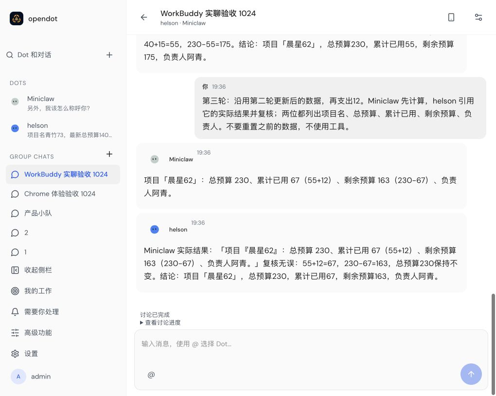
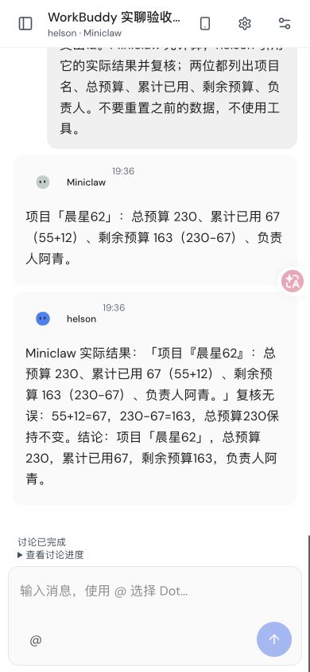
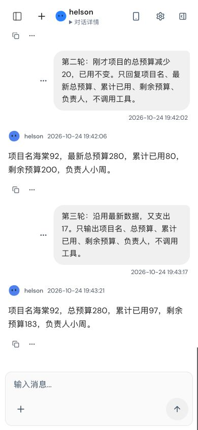

# WorkBuddy 实聊验收截图（2026-10-24）

使用本机 Magpie → WorkBuddy 真实模型，在 Chrome 中操作 OpenDot 完成验收。
对应功能提交：[`7b16668`](https://github.com/helsome/OpenDot/commit/7b16668711ec8e46ca9a3348db5c1fee32033c33)。

| 场景                     | 连续用户轮次 | 核对结果                                                                      |
| ------------------------ | ------------ | ----------------------------------------------------------------------------- |
| 单聊：海棠92，负责人小周 | 3            | 余额依次为 220、200、183；项目和负责人保持正确                                |
| 群聊：晨星62，负责人阿青 | 3            | Miniclaw 与 helson 每轮分别回复，后者引用并复核前者；余额依次为 160、175、163 |

第三轮前刷新页面，完成后再次刷新，核对上下文和消息持久化。
单聊最终三轮使用同一个 Docker 容器，没有出现续聊权限错误或重复回复。
群聊使用本机 Node Durable 运行时，没有再出现协调 Dot 声称自己“未被调度”的问题。

截图展示验收结束时的真实界面；三轮结论还核对了持久化消息，并非仅凭截图判断。
手机布局为 Chrome 的 390 × 844 响应式视口，不代表物理手机或独立 Cloudflare 运行时已验证。
指定对话用例通过，完整回归另有冷启动超时，不能据此认定全量测试通过。

## 群聊：桌面端

## 群聊：手机布局

## 单聊：手机布局

