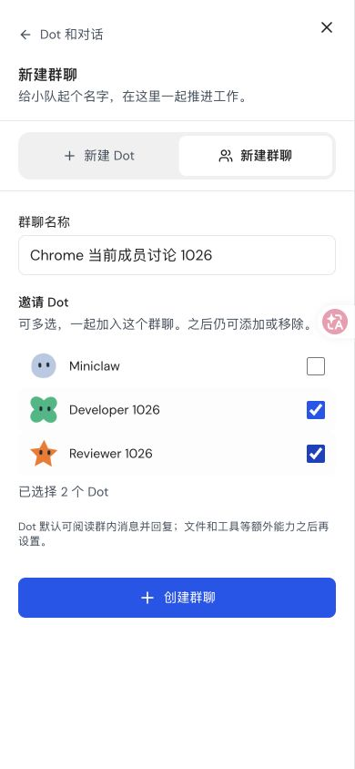
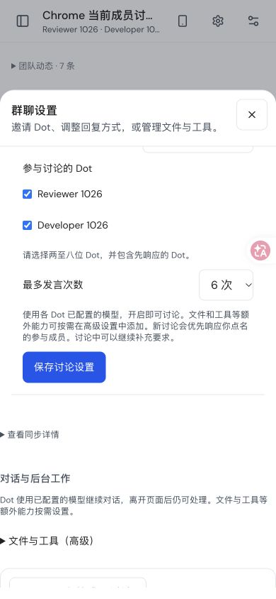
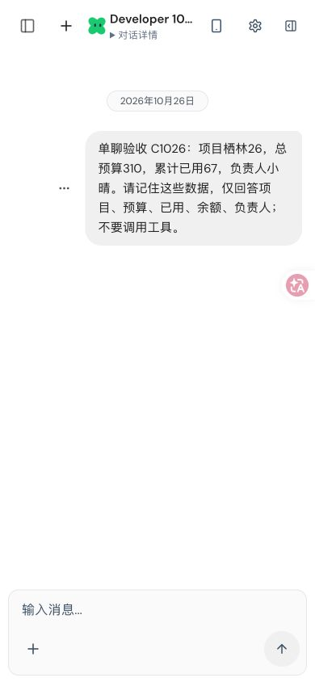

# 当前版本 Chrome 验收 · 2026-10-26

这些原始截图来自隔离的本地实例，运行源版本为
`d44e7463d46a369623dfd85425a51be46f1dd593`，Google Chrome 视口 390×844。
没有修改用户原有的 3000 服务。截图保持原始像素，hash 和测试范围见
[acceptance.json](acceptance.json)。

## 创建和找回群聊

通过界面创建 Developer 1026 和 Reviewer 1026，创建群聊时一次勾选两位 Dot，
取消默认 Miniclaw。无需选择“使用哪个 Dot 的对话环境”。

[创建后的群聊](group-created-mobile.png)包含两位预期 Dot；随后从“Dot 和对话”
搜索并[找回同一个群聊](group-find-mobile.png)。

## 讨论设置和返回设置

通过界面先启用 relay-v1，再保存 member-inbox-v1。两个有界网络窗口均有
真实 PATCH/200，记录没有截断，见 [首次启用](first-enable-network.json)和
[成员协作设置](member-enable-network.json)。默认每位 Dot 只有文字对话能力，
模型尝试上限 4 次；没有为验收预先增加文件或工具授权。

[消息渠道返回设置侧栏](channel-return-settings-mobile.png)已通过可见界面操作。
群聊设置是底部面板，全局设置从左侧打开；不宣称所有面板方向已统一。

## 未通过：当前版本首次单聊

创建和设置时还没有模型调用。首次单聊使用实际 Magpie WorkBuddy
`workbuddy-ai/deepseek-v4.1-flash`，四次真实上游请求全部返回 HTTP 429。
原生 SDK 均记录 error，页面最终只有用户消息，没有助手回复，也没有可见错误。
本次单聊验收未通过，群聊实聊尚未开始，后续模型调用已暂停。

[失败观察记录](single-first-upstream-failure.json)保留原始结果，不作为三轮通过证据。
上一轮已通过的 WorkBuddy 单聊和群聊各三轮截图，见
[2026-10-25 验收](../workbuddy-acceptance-2026-10-25/README.md)；那轮是原有用户实例，
不能代替这里的当前版本实聊验收。

这些是桌面 Chrome 的手机宽度测试，未覆盖物理手机、真实输入法、Cloudflare staging，
也未证明 warm Container ID 连续复用。未导出密钥、cookie、鉴权头、原生私有控制信封
或完整用户数据库。页面上的粉色翻译浮标属于测试浏览器扩展，不是 OpenDot 控件。

## 已完成的本地回归

冻结运行时代码 `d46381cb35ebd344c0be33bcac76e42f2c734e9f` 的完整检查已结束：
Root 3352 通过、23 项既有跳过；Authority 110 通过；workerd 86 通过；
建群及导航浏览器 8 项、成员并发 1 项、成员 Stop 1 项全部通过。类型检查、
Worker dry-run、Web 与 runner 构建也通过。

[源版本固定的完整门禁记录](runtime-gates-d463.json)保留命令、退出码、日志 hash
和之前命令失败的记录。这些受控回归与上面的真实模型失败是不同证据；
不以回归通过替代实聊，也不声明当前远程 CI 或生产部署已通过。
