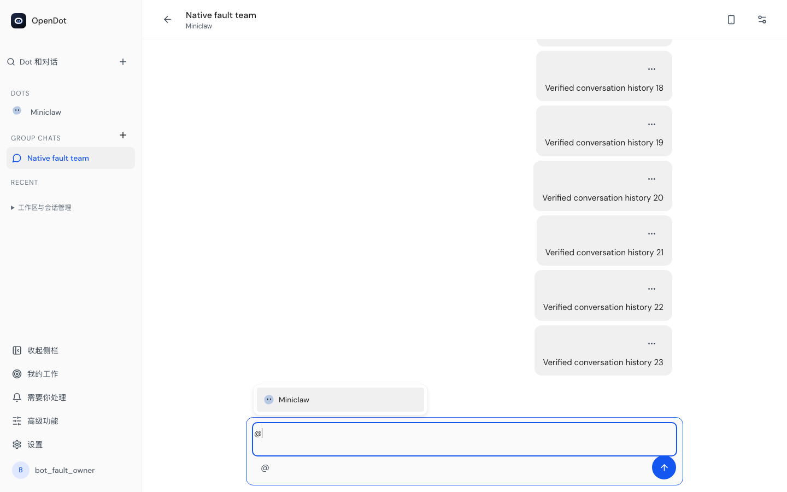
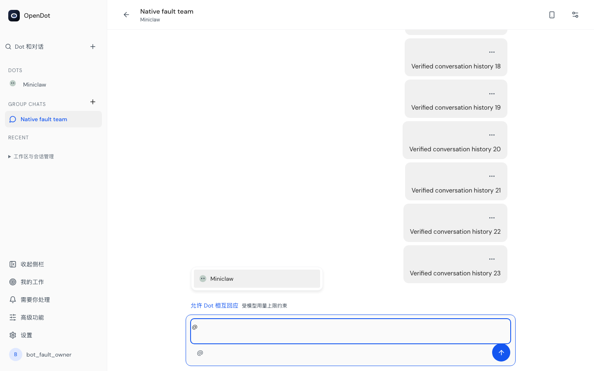
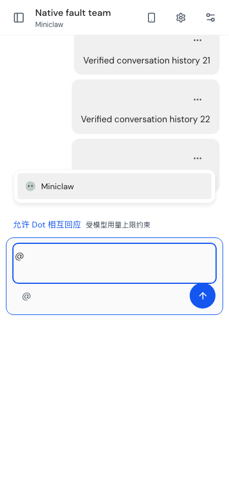

# 群聊恢复、菜单与浏览器返回 · #75

补跑旧群聊浏览器链路发现了三个产品问题，以及几处已过时的测试交互。
修复后，`864f1d5` 的 18 项浏览器检查全部通过：恢复/审批/历史 8 项、
创建/导航 8 项、成员并发 1 项、单成员 Stop 1 项。
生产源码与 `0f8ecd6` 一致；该源码的完整类型检查、4 文件 17 项相关回归和
Web 生产构建通过。[命令、日志 hash、源码与截图索引](gate-results.json)
按各自版本记录，不将这些专项称为新的完整 Root/Authority 队列。

## 产品修复

- **@ 菜单遮住讨论控件。** 原菜单仅相对文本框定位，桌面菜单底部为 760，
  整个输入停靠区顶部为 719，超过原断言允许的 735。现在测量完整停靠区的
  偏移，讨论开关、审批和 Stop 等控件高度改变时也避开它们；原几何阈值未改。
- **群聊切到单聊后，后退再次进入单聊。** `/bots?profile=…` 是鉴权后的入口
  解析页，原本又新增一条历史记录，造成 Back 回到中转页后再次重定向。
  自动入口现在替换中转记录；团队页面中主动选择 Dot 仍正常新增历史记录。
  浏览器实际验证了群聊→单聊→后退群聊→前进单聊→再次后退。
- **异常重试入口无法触摸。** 未核实/异常状态现在显示可见刷新图标，实测
  宽高均至少 44px。正常同步时仍不常驻显示成功文案。

## 菜单截图

均来自隔离测试账户与 Chromium，不包含真实用户历史或供应商实聊。

修复前，菜单覆盖输入停靠区上方的讨论开关：



修复后，菜单与讨论控件分开：





手机截图为桌面 Chromium 的视口和 visualViewport 仿真，不是物理手机或真实输入法验收。

## 恢复和权限验证

同一用例通过实际 HTTP、持久存储和浏览器覆盖响应丢失后原标识重试、两设备
并发发送、离线、SIGKILL 后恢复、分页、成员撤权、统一导航、Workspace 策略
撤回和退出登录。恢复前后原消息、epoch、revision、提交次数分别核对。
最后仍只有三次被记录的手机提交，没有因导航、恢复、退出而自动补发。
原生账户隔离另有[双账户专项](../member-inbox-77/cross-user-2026-10-26/README.md)。

## 保留失败与默认门禁

五次未通过的完整八项执行分别保留：

| 记录                                   | 结果与原因                                                            |
| -------------------------------------- | --------------------------------------------------------------------- |
| [108154d](first-failure-108154d.json)  | 6/8；真实菜单遮挡，以及测试关闭了默认展开的成员设置                   |
| [c8a51e7](second-failure-c8a51e7.json) | 7/8；菜单已通过，旧测试点击隐藏刷新并期待已移除的同步成功文案         |
| [65dd6b1](third-failure-65dd6b1.json)  | 7/8；列表选择器同时匹配侧栏与内容行                                   |
| [af37598](fourth-failure-af37598.json) | 7/8；发现真实浏览器后退重定向环                                       |
| [0f8ecd6](fifth-failure-0f8ecd6.json)  | 7/8；后退已通过，但手机尚未读取撤权状态，测试错测了正常状态的隐藏控件 |

现在测试先通过可见界面进入正确状态，再执行原断言；未增大期限、放宽 ACL、
强制点击隐藏控件或删除后退/44px/消息一致性断言。超时后的上下文关闭即使失败，
也会清理该用例自己的服务。原始 trace 含隔离账户 cookie，仅在本机保留，未公开。

默认 `web/playwright.groups.config.ts` 现在包含讨论、账号恢复和会话导航三个
文件，后续直接运行即可覆盖这八项，避免只跑六项讨论流程遗漏恢复与导航：

```bash
cd web
node ../scripts/run-node-cli.mjs playwright test --config playwright.groups.config.ts
```

该公开默认命令已再次通过全部八项（2.2 分钟，输出检查通过），见
[默认入口复测](default-gate-results.json)。这是上面八项的重复执行，不另加为八个独立用例。

这是隔离 UI/Runtime 回归。最新 Chrome WorkBuddy 三轮实聊仍受上游 429 影响，
Cloudflare staging 与物理手机未通过；新成员模式继续默认关闭。
