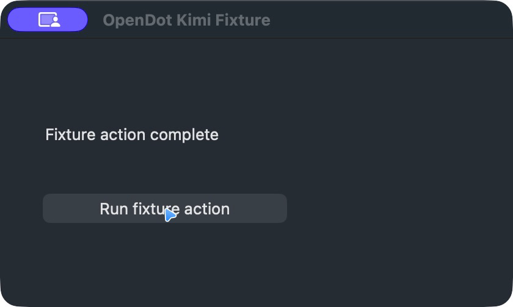

# KimiCU direct local fixture, 2026-10-28

An additional real KimiCU backend test used a synthetic window whose action
increments a visible counter. An invalid window ID was rejected; after a newer
native snapshot performed one click, a click using the older snapshot was
rejected and the counter remained at one. The direct backend test passed (one
test, 0.49 seconds); the paired-device product test passed separately against
the revised fixture (one test, 10.56 seconds). This does not prove that every
possible app or a target change racing an already dispatched action is fenced.

The paired-device product test additionally revokes the device MCP grant
after the three approved fixture operations. A synthetic model then requests a
new observation; the real device command ledger remains unchanged. This
post-revocation check passed against an isolated macOS fixture (one test,
10.21 seconds). It does not establish real-model revocation behavior or
revocation racing an already dispatched operation.

A later real-device fixture run (one test, 9.70 seconds, synthetic model)
also requested observation while the grant was active, waited for its exact
approval, revoked the grant and submitted a late approval. No device command
was added; the subsequent post-revocation request was also blocked. This
covers revocation while waiting for approval, not an already dispatched action.

The actual WebBridge paired-device test also passed after adding a revoked
grant turn (one test, 8.64 seconds, synthetic model). It returned to a fresh
allowed fixture page, revoked the grant and had the model request another
read. Both the device command count and the page's read counter stayed
unchanged. This checks only read requests made after revocation; navigation,
click, fill and screenshot remain unavailable through this adapter.

The real WebBridge fixture subsequently passed a waiting-approval revocation
case (one test, 8.75 seconds, synthetic model). A page-read approval was
pending when the grant was revoked; a late approval caused neither a device
command nor a read of the in-scope fixture page. A separate request after
revocation was also rejected before reaching the page.

The installed vendor KimiCU 0.6.8 MCP server observed a dedicated synthetic
macOS test app, then clicked its single test button using the actual process,
window, element index and native snapshot identity. A second observation
showed the synthetic completion label; a later call using a fabricated snapshot
identity was rejected. This was a direct vendor-protocol check, not an OpenDot
approval or device-channel test. No other application was targeted.

The vendor returned the synthetic window screenshot as JPEG. The included PNG
was produced by decoding the screenshot and re-encoding only pixel data, so no
JPEG metadata is retained. This screenshot does not establish model vision,
OpenDot attachment authorization, cross-app fencing or Cloud support.

## Fixed-window adapter

Two instances of the synthetic app were opened with different process and
window identifiers. KimiCU rejected using the first instance's snapshot with
the second instance; the second fixture stayed unchanged. The new OpenDot
`KimiCuBackend`, wrapped in `KimiDesktopTargetPolicy`, then observed the
second fixture and successfully clicked its test button. The adapter restricts
native calls to a locally selected app, process, window and snapshot.

This check exercised the real KimiCU process and the local policy, with a
test-only authorization callback. It did not use a paired device, a product
approval record, a real model, or an OpenDot chat. Those remain separate
acceptance requirements. The cross-process probe demonstrates that specific
rejection; it is not proof of every possible native race.

## Paired-device product approval regression

The opt-in `tests/kimi-cu-product-live.test.ts` exercised a real KimiCU MCP
server through the OpenDot host, a paired device, a device grant, startup
consent and three separate exact-argument approvals. The model was a fixture.
The approved tools observed the isolated app, clicked its button, and captured
the window. An independent native observation confirmed the completion label.
With the separate image grant enabled, the real JPEG screenshot was stored as
a PNG attachment and excluded from text-only model requests and device logs.
The test does not establish real-model behavior, browser origin fencing or
Cloud deployment.

To reproduce, compile `tests/fixtures/kimicu-app/main.swift` into a macOS app
with bundle identifier `net.opendot.kimi-fixture`, start a fresh instance,
and obtain its process and window IDs using KimiCU `list_windows`. Build the
project, then set `OPENDOT_TEST_KIMICU_PID` and
`OPENDOT_TEST_KIMICU_WINDOW_ID` to that fixture before running the test. The
test is skipped when those values are absent. KimiCU and its required macOS
permissions must already be installed and enabled.

## Real-model paired-device run

On source head `5d56613`, the paired-device test passed with the real KimiCU
0.6.8 service and the user-authorized local Magpie `opencode-go-3/beam-free`
model. The model requested observation, one click and a screenshot, each with
an exact-call approval; an independent native observation confirmed the
isolated fixture button changed, and one encrypted PNG attachment was stored.
The fixture model endpoint received no requests. The model is text-only, so
this does not establish actual model vision or screenshot interpretation.
No unrelated app was targeted.

The same paired-device fixture passed separately on integrated head `fedfa33`
with the synthetic model, after the shared desktop lock and image-grant check.
