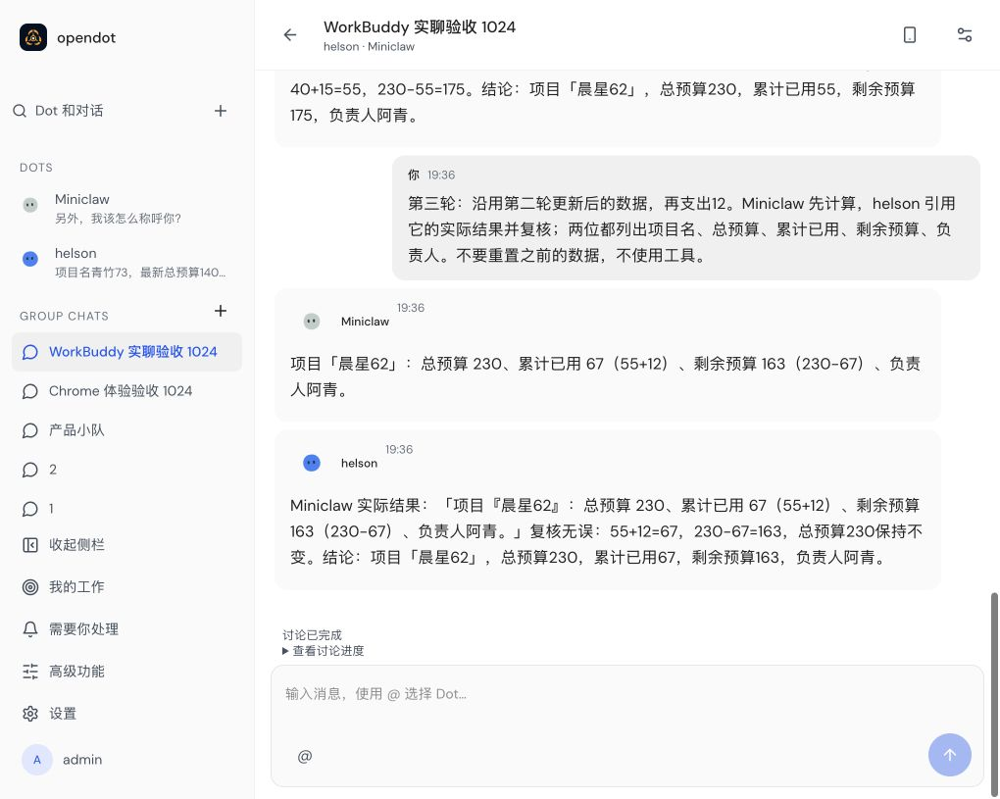
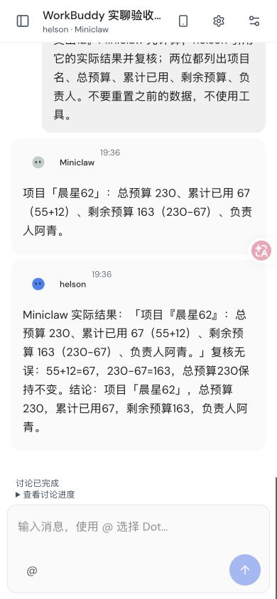
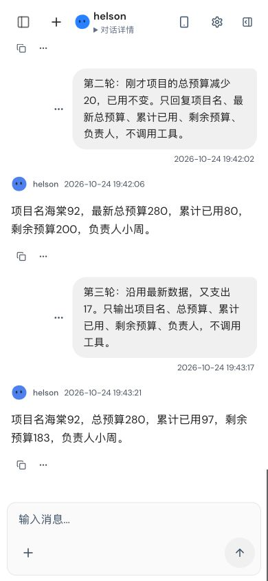

# 成员暂时性模型故障与工具确认前恢复（#78）

本记录对应 `f71c302bad8f7a40bf3bd863351a423b938a4b9c`。通过实际产品 API 创建
群聊、Dot、默认文本权限和显式产物权限，执行真实 Node Pi Durable / 本地 workerd
原生输入、Task、审批和文件写入。模型 SSE、单次 503/429 和 Authority 进程退出
由隔离 fixture 控制；没有真实厂商推理、生产 Cloudflare 或 Chrome 验收声明。

## 12 项原生产品用例

| 故障                                  | Node→Node | Node→Cloud | Cloud→Node | Cloud→Cloud |
| ------------------------------------- | --------- | ---------- | ---------- | ----------- |
| 同伴单次 503                          | 通过      | 通过       | 通过       | 通过        |
| 同伴单次 429                          | 通过      | 通过       | 通过       | 通过        |
| 产物落盘后、工具确认前 Authority 退出 | 通过      | 通过       | 通过       | 通过        |

暂时故障用例先让 A 发出真实问题并继续独立工作，再让 B 的第一次请求失败。
恢复后 B 回答原问题，A 实际消费这份回复后完成。每例 5 次模型请求、已报告用量
152；失败请求的未知用量保留整笔预留，没有以恢复为由退款。Node 同一生成 Task
的原生 attempt 为 `[1,2]`；Cloud 的原生模型重试关闭，通过既有 Lifecycle 在
新 owner 下恢复同一 Task，因此原生 attempt 为 `[1,1]`，两个实际请求分别计费。
原 question、delivery、input、Submission、Task、payload 和期限保持关联。

工具恢复用例只额外授权 B 的 `create_approved_artifact`，等待真实人工审批后，
在文件 fsync/校验完成、数据库完成回执和原生 Tool 返回尚未提交时 SIGKILL
自己的隔离 Authority。重启后同一个工具 Task/审批继续，沿用原问题和输入，
生成同伴回复与 A 的最终答案。每例 6 次模型请求、已报告用量 190；一份在途
模型的未知用量仍保守计量。最终只有一个产物文件，内容、inode、mtime 均未改变。
没有伪造旧 Task 已完成、创建替代群/Session 或再次征求同一份审批。

退出钩子使用既有 `afterEffect` 故障点，记录原始与执行 JS hash；不改 dist、
时钟、权限或生产恢复逻辑。公开文件、独立数据库和原生回执都在各自临时目录。
之后再次重建 Worker/Node，断言消息持久化且无新增模型调用。

## 证据与门禁

`manifest.json` 固定源码版本、全部来源 hash、12 份记录和私有原记录 hash。
每份 JSON 保留原生来源、邮件因果、模型调用区间、预算账本和规范群历史；
重复的 payload/provider envelope 转成 hash，单份逻辑 envelope 仍保留。
Run 期限与完整旧输入的前后相等检查在原生测试断言中；JSON 同时保留邮件期限、
原输入元数据与 digest。摘要是 fixture 用量，不是 WorkBuddy 费用。

- 暂时模型故障完整文件：8 项通过，166.82 秒。
- 工具恢复完整文件：4 项通过，225.38 秒。
- 两份日志通过仓库的 uncaught/Unhandled 输出检查。
- 两个首次定向探针各通过 1 项；其余是命令筛选，完整文件随后全部执行。
- 完整 `make typecheck` 通过，包含两个新原生文件、Web/E2E/Runner、共享类型、
  Prompt 与 91 文件文档检查；Worker dry-run 也通过。命令与日志 hash 见
  [gate-results.json](gate-results.json)。

共 64 次模拟模型请求，已报告 1,976 token；12 次未知用量仍保留预留，保守计量
总和 1,587,128。每例使用独立临时 owner，不把跨 fixture 汇总当成一个用户的账单。
校验：

```bash
node docs/verification/member-cloud-78/resilience-2026-10-25/validate.mjs
```

该脚本只检查保存记录、固定 Git 源码、四组合覆盖、来源/期限、单 Session HTTP
并发不超 1、Group 不超 2、预算和产物身份，不重新执行推理或故障。
实际复跑需先构建当前 Worker dry-run bundle，再执行两个完整文件：

```bash
npm run test:cloud-authority -- tests/group-member-resilience-cloud-http.test.ts
npm run test:cloud-authority -- tests/group-member-effect-recovery-cloud-http.test.ts
```

父实现 `34c17f4` 的完整 Root 435 文件 / 3352 项通过 / 23 项既有跳过，Authority
13 文件 / 70 项通过，单独见 [完整门禁](../../runtime-gates-2026-10-25.md)。
这 12 项不属于那次旧门禁。随后在冻结提交 `df304dd` 上实际运行完整 Authority，
15 文件 / 82 项全部通过（Vitest 1344.65 秒，命令 1346.32 秒），仓库输出检查通过；
对应源码、命令、完成时间和日志 hash 见上面的门禁 JSON。
本切片只增加测试、故障 fixture 与证据，没有修改生产运行时或默认开关。

Workspace/模型撤权、独立预算与资源冲突、更广 Authority 离线边界、灰度关闭、
当前 Chrome/手机与部署验收继续待完成。单一可安全重放的本地产物恢复不等于
所有外部副作用 exactly-once。#75–#78 的完整目标保持进行中。

## WorkBuddy 实聊截图

以下是 2026-10-24 在 Chrome 中使用本机 Magpie → WorkBuddy 完成的实聊验收截图，
对应功能源码 `7b16668`；它们不是本次 82 项受控模型回归的截图。
[原验收记录与三轮结果](../../../screenshots/workbuddy-acceptance-2026-10-24/README.md)
保留了单聊 220 → 200 → 183、群聊 160 → 175 → 163，以及刷新后的消息持久化核对。
手机布局使用 Chrome 390 × 844 响应式视口。







2026-10-25 的[三轮真实模型追加验收](../../member-concurrency-78/serial-correction-2026-10-25/README.md)
另行记录了两个协议的 20 次真实 API 请求和回复来源；该次没有新的 Chrome 截图。
