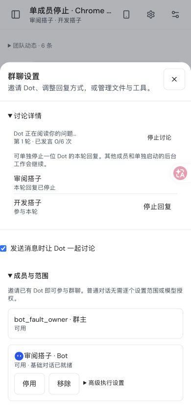
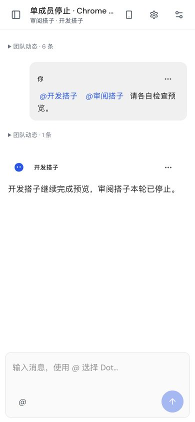
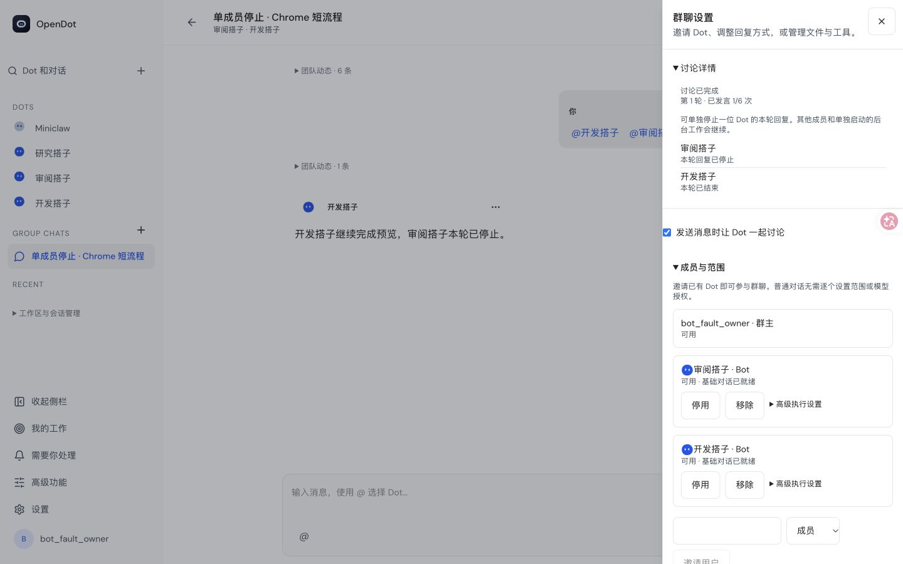

# 单独停止群聊 Dot（#78，2026-10-25）

本切片为实验中的有界成员 Run 提供单成员停止入口，使用原有 Product Runtime、
Pi Session、Cloud 签名 Stop 和恢复扫描。群聊设置 → 讨论详情可停止一位 Dot；
其他成员和独立授权的后台工作继续。默认聊天表面没有新增并发仪表盘。

停止事务先保存不可变 lease 来源、取消关联邮件并撤销目标的待审批意图，再等待
真实原生停止。没有确认时显示 uncertain；不会把原生等待 Task 伪标完成以释放容量。
Run 的取消 epoch 不变，停止接收者或提问者均不伪造 peer reply，也不唤醒闲置旁观者。
旧 Stop 的回执和签名请求均不能取消同一持久 Session 的新 Run。

## 原生证据

通过实际建群/选择 Dot/授权运行时/开启成员模式的产品 API，从真实 Node Pi Durable
和 local workerd PiHarness 获得输入与回执；只有 provider 输出可控。
没有提前插入授权、假群消息或原生 Task。以下 14 份 JSON 属于 10 项测试：

| 场景                                                     | 组合                                           | 可核对记录                                                                                   |
| -------------------------------------------------------- | ---------------------------------------------- | -------------------------------------------------------------------------------------------- |
| 停止接收者，提问方继续，下一轮不受旧 Stop 影响           | Node→Node、Node→Cloud、Cloud→Node、Cloud→Cloud | `stop-reviewer-*` 与 `stop-reviewer-reuse-*`，每组共 6 次调用：原 Run 4 次、新 Run 2 次      |
| 停止提问方，接收者继续，旧问题不再生成答案或唤醒         | 同上四种组合                                   | `stop-sender-*`，每组 4 次调用；实际接收任务完成，有原生结果来源                             |
| 未接收输入、尚未 provision 的 Cloud 成员停止             | Node + Cloud                                   | `stop-idle-cloud.json`，仅未停止的 Node 调用 1 次；没有 Cloud Stop RPC 或本机替代执行        |
| 原生已停止但 ACK 被丢弃，Node 和 Worker 重启后原范围确认 | Cloud 目标                                     | `stop-cloud-lost-ack-restart.json`，模型仅调用 1 次，3 次确认丢失；停止 fence 和冻结输入保留 |

每份记录保留原始 input/request/Submission/Task、问题/回复 ID、成员 lease、
调用时段与单调事件顺序、共享模型账本和源文件摘要。调用时段覆盖整个 fixture，
复用案例的两份 JSON 因此都含 6 次调用；`model_dispatches` 与 Run 预算按各自 Run 归属。
停止的请求缺少可靠 token 结果时按原有完整预留记作 uncertain，不能将其计为零成本。

运行只读校验：

```bash
node docs/verification/member-cloud-78/stop-2026-10-25/validate.mjs
```

该命令只报告 artifact_integrity_ok；完整验收、Chrome console 和 HTTP 覆盖分别列出。
校验源文件摘要、真实完成输入的 product/native 关联、模型终态、同 Session 复用、
Stop 来源和截图摘要。JSON 是隔离 fixture 记录，不能代表真实厂商质量或生产部署。

## Chrome 与手机布局

Chrome 中实际使用 + → 多选两位 Dot → 创建群聊 → 显式启用成员问答 → @两位 →
单独停止审阅搭子。开发搭子保留执行并给出唯一最终回答；刷新后仍可找到该消息。
`chrome-ui.json` 保存停止前后权威状态、原生输入与源代码/截图摘要。仅 2 次可控模型调用。
短流程发送/Stop 窗口捕获 106 个响应，包含 Stop HTTP200，无截断或失败；
仅证明该有界窗口。Chrome 翻译扩展产生一条 console error，保留为不清洁结果，
不将此样本标为完整 skill 通过。先前长时间 hold 的 4 次调用与重试账本另存
`chrome-retry-observation.json`；公开主截图对应短流程的 2 次调用。

隔离 Playwright 另外验证 Stop 响应丢失、刷新、原标识/原 lease 重试、只有一条 Stop 记录，
并检查 API/console/page 错误。仅首次未登录 `/api/auth/me` 的 401 和确切注入的失败请求
可被识别；不忽略其他 401、resource error 或失败响应。

手机视口 390×844、390×480 键盘高度模拟，桌面 1440×900；深浅色、44px 停止/关闭动作
和无横向溢出均有自动断言。它们不是物理手机键盘验收。







## 回归与限制

本切片的完整回归结果见 [验证结果](validation.md)。最初保留了两类失败：辅助监听端口被
错误认作 Web 导致启动等待，以及证据导出源文件路径写错。前者有独立失败用例和修复后
回归；后者修正后重新生成整套证据，没有把失败报告算作通过。

数据库迁移 v92 升级前备份并拒绝降级，保留历史 Cloud owner revision、native 来源和
不确定支出；停止标记不可更新或删除。旧 serial-v1 和未启用并发的 Run 不增加该入口。

#78 仍缺完整负向矩阵、自然真实模型与旧 relay 对照、生产 Cloudflare staging 及完整发布
门禁；本记录不关闭这些项目。历史 WorkBuddy 单聊/群聊三轮图片在
[原实聊记录](../../../screenshots/workbuddy-acceptance-2026-10-24/README.md)，不是新模式实聊证明。
